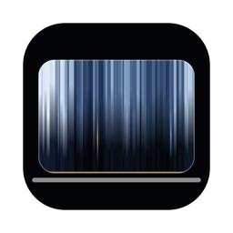

<p align="center"></p>

# Corners

A tiny macOS menu bar app that rounds your display corners to match the
rounded corners of notched MacBook Pro and MacBook Air screens.

- **Notched MacBook** (2021 M1 Pro/Max and newer, M2+ Air): the panel already rounds the
  top corners, so Corners rounds only the bottom two to match.
- **Older MacBooks** with no notch: rounds all four corners.
- **External displays**: rounds all four. Each display has its own settings.

The corners don't catch clicks, so hot corners still work, and they're left out of
screenshots, just like real hardware corners. Requires macOS 13 or later. Works on
Apple silicon and Intel.

## Install

Paste this into Terminal:

```bash
curl -fsSL https://raw.githubusercontent.com/Fox-IV/Corners/main/install.sh | bash
```

It downloads the latest release into `/Applications` and opens it.

<details>
<summary>Downloading the .zip from Releases instead?</summary>

Corners isn't notarized by Apple (that costs $99/year), so the first time you open it
macOS will say it *"could not verify"* the app. To open it anyway:

1. Try to open Corners.app once and dismiss the warning.
2. Go to **System Settings → Privacy & Security**, scroll down, and click **Open Anyway**.

Or run `xattr -dr com.apple.quarantine /Applications/Corners.app` in Terminal.
</details>

<details>
<summary>Build from source</summary>

Needs Xcode or the Command Line Tools (`xcode-select --install`).

```bash
git clone https://github.com/Fox-IV/Corners.git
cd Corners
./build.sh
open build/Corners.app
```
</details>

## Using it

Click the icon in the menu bar:

- **Round Corners** (⌘R): turns everything on or off
- **Per display**: turn it on or off, pick which corners, set the radius (0–40 pt), or reset to the auto-detected settings
- **Corner Style**: Continuous (Apple's squircle shape) or Circular
- **Calibrate Radius**: shows Corners' own corners in red and draws a guide line along the hardware's top corners. Raise the radius until the line just shows, then lower it one step, and the bottom corners will match the top.
- **Launch at Login**

## How it works

Corners checks your Mac's model and looks for a notch on each display. It then puts a
transparent, click-through window above everything (menu bar, Dock, full-screen apps)
and paints black corner masks into it. The code is in [`Sources/`](Sources/).

## Licence

MIT
